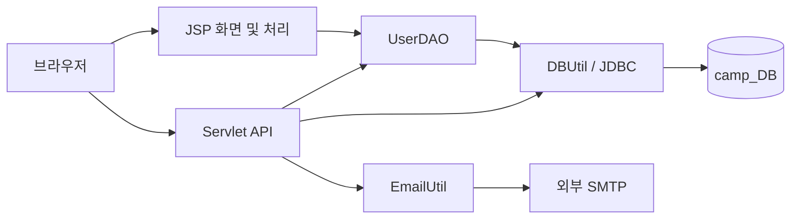

# 시스템 구조

[프로젝트 소개로 돌아가기](../README.md)

## 요청 처리

회원가입·로그인은 JSP 처리 파일에서 `UserDAO`를 호출합니다. 상품 Servlet은 `DBUtil`로 직접 쿼리하고 Gson으로 JSON을 반환합니다. `ProductDAO`와 `Product` DTO도 존재하지만 현재 상품 Servlet의 응답 경로에서는 사용하지 않습니다.

## 주요 파일

| 위치 | 역할 |
| --- | --- |
| `index.jsp` / `main.jsp` | 방문자 메인 / 로그인 사용자 이름을 표시하는 메인 |
| `register.jsp` / `register_process.jsp` | 가입 폼 / 가입 요청 처리 |
| `login.jsp` / `login_process.jsp` / `logout.jsp` | 로그인 폼 / 세션 생성 / 세션 해제 |
| `controller/` | 상품 조회, 아이디 중복 확인, 이메일 인증 API |
| `dao/UserDAO.java` | 가입, 로그인, 이름 조회 및 중복 검사 |
| `util/DBUtil.java` | JDBC 연결 생성 |
| `util/PasswordUtil.java` | BCrypt 해시 생성 및 비교 |
| `util/EmailUtil.java` | SMTP 메일 발송 |

Java 파일 경로는 `camp/src/main/java/`, JSP 파일 경로는 `camp/src/main/webapp/` 기준입니다.

## API

경로는 컨텍스트 `/camp`를 제외한 값입니다.

| 메서드 | 경로 | 파라미터 | 응답 |
| --- | --- | --- | --- |
| GET | `/product` | 없음 | `name`, `price`, `image`의 JSON 배열 |
| GET | `/user/checkId` | `username` | `available` 또는 `taken` |
| POST | `/email/send` | `email` | 전송 결과 텍스트 |
| POST | `/email/verify` | `email`, `code` | `ok`와 실패 시 `msg`를 포함한 JSON |

이메일 API의 POST 값은 폼 데이터로 전달합니다. 이메일 인증 코드는 DB에 저장하고 유효 시간을 검사합니다. 인증 성공 시 세션에 `verifiedEmail`을 기록합니다. 현재 가입 처리에서는 이 세션 대신 클라이언트의 `emailVerified` 값을 확인하므로 서버 검증을 연결하는 개선이 필요합니다.

## 데이터 모델

| 테이블 | 주요 컬럼 | 역할 |
| --- | --- | --- |
| `product` | `id` PK, `name`, `price`, `image` | 상품과 이미지 파일명 |
| `users` | `id` PK, `username` UNIQUE, `password`, `name`, `email` UNIQUE, `created_at` | 회원 정보와 비밀번호 해시 |
| `email_verification` | `email` PK, `code`, `expires_at`, `attempts` | 이메일별 인증 코드와 만료 시각 |

현재 SQL에는 테이블 간 외래 키가 없습니다. `attempts` 컬럼은 있으나 인증 시도 횟수 제한 로직은 구현되어 있지 않습니다. 초기 데이터는 상품 4개와 테스트 사용자 1개입니다.
